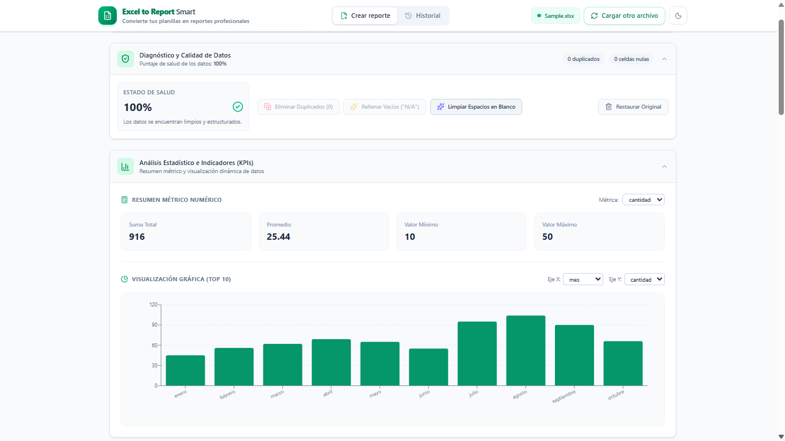

# 📊 Excel-to-Report Smart

> Convierte tus planillas Excel en reportes profesionales PDF — todo desde el navegador, sin backend.

[](https://react.dev/)
[](https://vite.dev/)
[](https://tailwindcss.com/)
[](./LICENSE)



---

## ✨ Características Principales

| Módulo | Descripción |
|---|---|
| 📁 **Carga de Archivos** | Arrastra o selecciona archivos `.xlsx` / `.xls` con validación automática |
| 🔍 **Explorador de Datos** | Tabla paginada con búsqueda global, filtro por columna y ordenación |
| ✅ **Calidad de Datos** | Diagnóstico automático: score de salud, detección de nulos/duplicados, limpieza integrada |
| 📈 **Análisis Estadístico** | KPIs automáticos (suma, promedio, min, max) y gráfico de barras Top 10 |
| 🎨 **Gráficos Interactivos** | 7 tipos de gráfico (Recharts), 5 paletas de colores, agregaciones, exportación PNG en alta resolución |
| 📄 **Reporte PDF** | Generación de PDF profesional con KPIs, gráficos, tabla de datos y 3 temas visuales |
| 📚 **Historial** | Gestión completa de reportes pasados con previsualización y re-descarga |
| 🌗 **Tema Claro/Oscuro** | Alternancia con detección automática del sistema operativo |

---

## 🚀 Inicio Rápido

### Prerrequisitos

- [Node.js](https://nodejs.org/) 18+ (recomendado: 20+)
- npm (incluido con Node.js)

### Instalación

```bash
# Clonar el repositorio
git clone https://github.com/MatiRaimondi1/Excel-to-Report-Smart.git
cd Excel-to-Report-Smart

# Instalar dependencias
npm install

# Iniciar servidor de desarrollo
npm run dev
```

La aplicación estará disponible en `http://localhost:5173`.

### Scripts Disponibles

| Comando | Descripción |
|---|---|
| `npm run dev` | Inicia el servidor de desarrollo con HMR |
| `npm run build` | Genera la build de producción en `dist/` |
| `npm run preview` | Previsualiza la build de producción |
| `npm run lint` | Ejecuta ESLint sobre el proyecto |
| `npm run test` | Ejecuta los tests una vez |
| `npm run test:watch` | Ejecuta los tests en modo watch |

---

## 🏗️ Arquitectura

### Stack Tecnológico

| Categoría | Tecnología |
|---|---|
| **Framework** | React 19 |
| **Bundler** | Vite 8 |
| **Estilos** | Tailwind CSS 4 |
| **Gráficos** | Recharts 3 |
| **Parseo Excel** | SheetJS (xlsx) |
| **Iconos** | Lucide React |
| **Fechas** | date-fns |
| **Routing** | React Router DOM 7 |
| **Testing** | Vitest 5 + Testing Library |

### Estructura del Proyecto

```
Excel-to-Report-Smart/
├── public/                     # Archivos estáticos
│   ├── favicon.svg
│   └── icons.svg
├── src/
│   ├── main.jsx                # Punto de entrada
│   ├── App.jsx                 # Componente raíz y navegación
│   ├── index.css               # Estilos globales
│   ├── assets/                 # Imágenes y recursos
│   ├── components/
│   │   ├── FileUpload.jsx      # Carga de archivos (drag & drop)
│   │   ├── DataExplorer.jsx    # Tabla interactiva de datos
│   │   ├── DataQuality.jsx     # Diagnóstico y limpieza de datos
│   │   ├── DataAnalysis.jsx    # KPIs y análisis estadístico
│   │   ├── GraphicsModule.jsx  # Gráficos interactivos (Recharts)
│   │   ├── PdfReport.jsx       # Configuración y generación de PDF
│   │   └── ReportHistory.jsx   # Historial de reportes
│   └── context/
│       ├── DataContext.jsx     # Estado global de datos
│       └── ThemeContext.jsx    # Estado del tema (claro/oscuro)
├── tests/
│   ├── setup.jsx               # Configuración de Vitest
│   ├── test-utils.jsx          # Utilidades de testing
│   ├── DataSynchronization.test.jsx
│   ├── IntegrationFlow.test.jsx
│   ├── components/             # Tests unitarios por componente
│   │   ├── DataAnalysis.test.jsx
│   │   ├── DataExplorer.test.jsx
│   │   ├── DataQuality.test.jsx
│   │   ├── FileUpload.test.jsx
│   │   ├── GraphicsModule.test.jsx
│   │   ├── PdfReport.test.jsx
│   │   └── ReportHistory.test.jsx
│   ├── context/                # Tests de contextos
│   │   ├── DataContext.test.jsx
│   │   └── ThemeContext.test.jsx
│   └── pages/
│       └── App.test.jsx
├── docs/                       # Documentación
|   ├── JSDoc                          # Documentación técnica
│   └── Diagrama de casos de uso.svg   # Diagrama UML de casos de uso
├── package.json
├── vite.config.js
├── eslint.config.js
└── LICENSE                     # GPL v3
```

---

## 📋 Módulos en Detalle

### 📁 Carga de Archivos

- **Drag & drop** o selección desde el explorador de archivos
- Formatos soportados: `.xlsx`, `.xls`
- Parseo automático de la primera hoja del libro Excel vía SheetJS
- Validación de formato al seleccionar el archivo

### 🔍 Explorador de Datos

- Tabla paginada con header sticky y scroll horizontal
- **Búsqueda global** de texto en todas las columnas
- **Filtro por columna** específica con substring match
- **Ordenación** ascendente/descendente por click en encabezado
- Paginación configurable: 10, 25, 50 o 100 filas por página
- Botón para resetear todos los filtros

### ✅ Calidad de Datos

- **Score de salud** automático (0-100%) con código de color
- Detección de **filas duplicadas** y **celdas vacías/nulas**
- Herramientas de limpieza integradas:
  - Eliminar filas duplicadas
  - Rellenar celdas vacías con "N/A"
  - Limpiar espacios en blanco (trim)
- Posibilidad de **restaurar datos originales** en cualquier momento

### 📈 Análisis Estadístico

- Detección automática de columnas numéricas
- **4 tarjetas KPI**: Suma Total, Promedio, Mínimo, Máximo
- Gráfico de barras con las **Top 10 categorías**
- Selección de columna de métrica y ejes del gráfico

### 🎨 Gráficos Interactivos

- **7 tipos de gráfico**: Barras, Barras Horizontales, Líneas, Área, Pastel, Dona, Compuesto (barras + líneas)
- **5 funciones de agregación**: Suma, Promedio, Conteo, Máximo, Mínimo
- **5 paletas de colores**: Esmeralda, Índigo Ejecutivo, Océano Cyan, Atardecer Cálido, Multicolor Vibrante
- Configuración de Top N (5, 10, 15, 20, Todos) y orden
- Métrica secundaria opcional para comparación dual
- Toggle de cuadrícula y leyenda
- **Exportación PNG** en alta resolución (2x)
- 4 KPIs del gráfico: Total Agregado, Promedio por Categoría, Líder, Categorías

### 📄 Reporte PDF

- **3 temas visuales**: Corporativo (Índigo), Financiero (Esmeralda), Formal (Pizarra)
- Configuración de título personalizado
- Secciones opcionales: KPIs y gráfico
- Máximo de filas configurable: 20, 50, 100 o todas
- **Previsualización en tiempo real** antes de exportar
- Generación vía `window.print()` con CSS de impresión optimizado
- Guardado automático en historial al exportar

### 📚 Historial de Reportes

- Lista visual con tarjetas de reportes pasados
- **Previsualización** completa en modal
- **Re-descarga** de reportes históricos como PDF
- Eliminación individual o limpieza completa del historial
- Persistencia en **localStorage** del navegador

---

## 🧪 Testing

El proyecto incluye una suite completa de tests con **Vitest** y **React Testing Library**:

```bash
# Ejecutar todos los tests
npm run test

# Ejecutar en modo watch
npm run test:watch
```

### Cobertura de Tests

| Tipo | Archivos |
|---|---|
| **Componentes** | FileUpload, DataExplorer, DataQuality, DataAnalysis, GraphicsModule, PdfReport, ReportHistory |
| **Contextos** | DataContext, ThemeContext |
| **Integración** | IntegrationFlow, DataSynchronization |
| **Páginas** | App |

---

## 🔧 Configuración

### Vite

La configuración de Vite se encuentra en [`vite.config.js`](./vite.config.js):

- Plugin React con Oxc
- Plugin Tailwind CSS v4
- Vitest integrado con jsdom

### ESLint

Configuración en [`eslint.config.js`](./eslint.config.js) con reglas para React Hooks y React Refresh.

---

## 📄 Licencia

Este proyecto está licenciado bajo la [GNU General Public License v3.0](./LICENSE).
